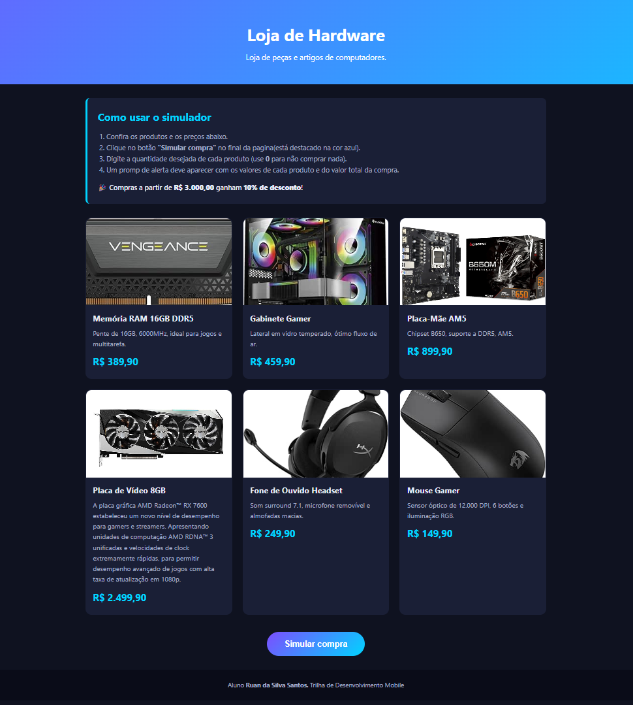

Nome da loja: Loja de Hardware(não tenho criatividade pra criar um nome)
Nome do aluno: Ruan da Silva Santos
Trilha: Trilha de desenvolvimento Mobile 

## Sobre a loja

A "Loja de  Hardware" é uma loja de componentes e periféricos para computador. A página apresenta os produtos e permite simular uma compra boa parte do objetivo é exercitar logica com javascript.

### Produtos e preços

| Produto | Descrição | Preço |
|---|---|---|
| Memória RAM 16GB DDR5 | 6000MHz, ideal para jogos e multitarefa | R$ 389,90 |
| Gabinete Gamer | Vidro temperado e 3 fans RGB | R$ 459,90 |
| Placa-Mãe AM5 | Chipset B650, DDR5 e PCIe 4.0 | R$ 899,90 |
| Placa de Vídeo 8GB | 8GB GDDR6 com ray tracing | R$ 2.499,90 |
| Fone de Ouvido Headset | Som surround 7.1 e microfone removível | R$ 249,90 |
| Mouse Gamer | 12.000 DPI, 6 botões e RGB | R$ 149,90 |

## Tecnologias

- HTML5
- CSS3 
- JavaScript

## Como executar

1. Baixe ou clone o repositório.
2. Abra o arquivo 'index.html' em qualquer navegador.
3. Na parte superior da pagina tem como utilizar a pagina, porém segue como utilizar a baixo.
4. Veja e confira os preços.
5. Clique em "Simular compra" um prompt ira abrir para colocar a quantidade de cada produto que deseja(6 produtos no total)(caso não queria adicionar um produto digite 0).
6. Quando terminar uma ganela de alert() ira abrir com o valor total de cada produto x quantidade, e no final, o valor total da compra.
7. pode fazer sempre que apertar o botão

## Captura de tela

## Testes realizados

| # | Cenário |
|---|---|
| 1 | Todas as quantidades = 0
| 2 | 1 Mouse e 0 nos demais 
| 3 | 2 Memórias RAM e 1 Fone.
| 4 | 1 Placa de Vídeo e 1 Placa-Mãe (R$ 3.399,80)
| 5 | Digitar texto que n seja numeros
| 6 | Digitar número negativo ou decimal.
| 7 | Clicar em "Cancelar" no prompt 

## Uso de IA

Utilizei IA (Claude) como apoio para gerar a estrutura inicial do projeto, em principal a parte do front e o layout da pagina pois queria um "site" mais bonito. Revisei o código, ajustei o nome da loja e os textos, e na parte de logica e javascript escrevi boa parte do codigoa mão, deixando apenas o claued me corrigir quando encontrava um erro ou em principal, esquecia qual a chamada das funções e de logicas especificas do codigo.

##  Dificuldade e aprendizado

A maior dificuldade foi com o css e HTML, não tenho muita expericencia real com front e por isso deixei a ia me guiar por boa parte dele. não me lembrava de algumas funções do javaScript e por isso tive que fazer repesquisar bastante. Bom desafio de nivelamento.
